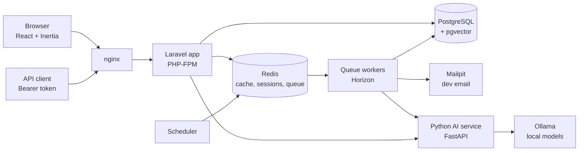

# Project Guide: AI Support Ticketing System

A plain-language walkthrough of what this project is, how each part works, and why it was built this way. Read it top to bottom before an interview.

---

## 1. The project in 30 seconds

A **multi-tenant help desk**. Each company (an _organization_) gets its own subdomain, e.g. `acme.localhost`. Customers raise tickets; agents and admins answer them against **SLA deadlines**. Everything a modern help desk needs is there: roles, file attachments, email and in-app notifications, a public REST API, background queues, and a knowledge base.

On top of that sits **local AI**, with no paid API and no customer data leaving the server:

- **Similar tickets:** agents see past tickets like the one they're reading.
- **Suggested replies (RAG):** one click drafts a reply from the knowledge base, with its sources; the agent edits it before sending.
- **Auto-triage** (next): suggest a category and priority for new tickets.

**Stack:** Laravel 13 (PHP 8.4), React + TypeScript (Inertia), PostgreSQL 17 + pgvector, Redis, a Python FastAPI service, Ollama (local models), Docker Compose, GitHub Actions.

---

## 2. Architecture

| Container   | Job                                                                         |
| ----------- | --------------------------------------------------------------------------- |
| `app`       | Laravel (PHP-FPM): web pages, API, business logic                           |
| `nginx`     | Web server in front of `app`                                                |
| `postgres`  | All data, plus vectors (pgvector) for AI search                             |
| `redis`     | Cache, sessions, and the job queue                                          |
| `queue`     | **Horizon**: runs background jobs (emails, embeddings, escalations)         |
| `scheduler` | Runs timed tasks (SLA breach check every 5 minutes)                         |
| `ai`        | **Python FastAPI**: the only thing that talks to the models                 |
| `ollama`    | Runs the models: `qwen3-embedding:0.6b` (embeddings) and `gemma3:1b` (text) |
| `mailpit`   | Catches outgoing email in development                                       |

**Rule of thumb:** Laravel owns the data and the rules; Python owns the AI calls; nothing slow happens inside a web request except an AI draft the agent explicitly asks for.

---

## 3. How each part works

### 3.1 Multi-tenancy: one database, many companies

**What:** All organizations share one database. Every tenant-owned table (`tickets`, `messages`, `users`, `kb_articles`, …) has an indexed `organization_id`.

**How a request finds its tenant:**

1. `acme.localhost:8088/tickets` arrives.
2. `ResolveOrganization` middleware reads `acme` from the host and loads that organization. Unknown subdomain → **404**.
3. It calls `$organization->makeCurrent()`, which stores the id in Laravel's **hidden Context** (per request, not logged).
4. Every tenant model uses the `BelongsToOrganization` trait, which adds a **global scope**: every query gets `where organization_id = <current>` automatically, and new rows get `organization_id` filled in.
5. **Fail closed:** if no tenant is set, the scope **throws** (`MissingOrganizationException`) instead of returning every company's data.

**Queued jobs:** Laravel carries Context into jobs, so a job runs under the same tenant that queued it. The scheduled SLA command loops over organizations and calls `makeCurrent()` for each.

**Why not one database per tenant?** Simpler operations (one migration, one backup, one vector index). The cost: isolation lives in code, so one missed scope could leak data. That's why scoping is automatic and tested at two levels (models and real HTTP requests). See ADR-001.

### 3.2 Users, roles, and permissions

- Three roles: **admin**, **agent** (both "staff"), **customer**. One role per user. No permissions package; three roles don't need one.
- **Policies** decide access to one record (`TicketPolicy`: customers only see their own tickets; only staff change status, priority, or assignee). **Scopes** filter lists (`Ticket::visibleTo($user)`).
- Customers are users too, so requester, assignee, and message author all point to `users`.
- Login is per subdomain (Fortify); users are tenant-scoped, so an acme login doesn't exist on globex.

### 3.3 The ticket lifecycle

**Code shape:** controllers only _authorize → validate → call an action → respond_. The logic lives in **action classes** (`CreateTicket`, `ReplyToTicket`, `UpdateTicket`, `AddAttachments`, `SuggestReply`), so the web app, the API, jobs, and commands all reuse the same code.

1. **Create:** gets a reference (`TKT-1001`, `TKT-1002`, … per organization), a priority (default medium), and SLA deadlines from the organization's policy for that priority.
2. **Reply / internal note:** staff can add internal notes that customers never see. The first public staff reply records `first_responded_at`. A customer reply reopens a pending, resolved, or closed ticket.
3. **Update:** status, priority, assignee. Each change is logged as a system message. Changing priority recalculates the SLA deadlines.
4. **Statuses:** `open`, `pending`, `on_hold`, `resolved`, `closed`. `resolved_at` / `closed_at` are stamped by a model hook, so any status change, from anywhere, is recorded correctly.
5. **Attachments:** up to 3 files of 5 MB, stored on a private disk, downloaded only through an authorized route; files on internal notes are hidden from customers.

### 3.4 Events and queued listeners

Actions **announce** what happened; **listeners** do the side effects. The request never waits for email.

| Event                 | Listener(s)                                                                   |
| --------------------- | ----------------------------------------------------------------------------- |
| `TicketCreated`       | email staff (queued); queue the ticket's embedding                            |
| `TicketReplied`       | email the other side (customer ↔ assigned agent), plus an in-app notification |
| `TicketAssigned`      | email + in-app notification to the new assignee                               |
| `TicketStatusChanged` | (no listener yet: ready for future features)                                  |

**Why:** adding a feature (e.g. auto-triage) means adding a listener, not editing the action.

### 3.5 SLA and breach escalation

- **SLA policy** per priority: minutes to first response and to resolution. Deadlines are **stored on the ticket** at creation, so editing a policy later doesn't move existing deadlines.
- **Breach check:** the `scheduler` container runs `tickets:check-sla` every 5 minutes. For each organization it finds open tickets past a deadline that wasn't met and **hasn't been escalated yet**, stamps `first_response_breached_at` / `resolution_breached_at`, and queues `EscalateTicket`.
- **Escalation job:** adds a system message to the ticket and notifies admins and the assignee (email + bell).
- **Exactly once:** stamping the breach column before queuing means a breach is escalated once, however often the check runs. `withoutOverlapping()` stops two checks running at once.

### 3.6 Notifications

- **Email** for new tickets, replies, assignment, and SLA breaches (Mailpit catches them in dev).
- **In-app bell** in the header: unread count and the latest 10 (assignment, reply, breach), stored in Laravel's `notifications` table. Opening one marks it read and goes to the ticket.
- The `notifications` table has no `organization_id`: every read goes through the logged-in user, who already belongs to one organization.

### 3.7 Public REST API

- **Base:** `/api/v1` on the tenant subdomain, e.g. `acme.localhost:8088/api/v1/tickets`.
- **Auth:** Laravel **Sanctum** tokens. `POST /api/v1/tokens` with email and password returns a token; send it as `Authorization: Bearer <token>`. A token used on another organization's subdomain finds no user → **401**.
- **Endpoints:** list, show, and create tickets; reply; revoke the token.
- **Same rules as the web app:** customers see only their own tickets and never internal notes.
- **API Resources** give one fixed JSON shape and keep internal ids and vectors private.
- **Rate limit:** 60 requests per minute per user → **429**.
- **Docs** generated by **Scribe** at `/docs`. Versioned (`v1`) so it can change without breaking clients.

### 3.8 Queues and Horizon

- Jobs go to **Redis**; **Horizon** runs the workers and has a dashboard (`/horizon`) for throughput, failures, and retries.
- Jobs: emails (queued listeners), `EmbedModel`, `EscalateTicket`. Each has retries.
- **Timeouts fit together:** Ollama call 120 s < job HTTP timeout 130 s < worker timeout 150 s < Redis `retry_after` 180 s. So a slow model fails cleanly and is retried, and a job is never run twice at the same time.
- Horizon shows every organization's jobs, so **tenant admins can't open it**; only platform operators.

### 3.9 Knowledge base

- Staff manage articles: list with search, create, edit, delete; statuses draft, published, archived.
- The slug comes from the title once and stays unique per organization (`-2`, `-3`, …), so links never break.
- Publishing stamps `published_at`; going back to draft clears it.
- Articles are the **facts** that AI-suggested replies are built from.

---

## 4. The AI part

### 4.1 Why a separate Python service?

- **One place for all AI:** timeouts, retries, model choice, and prompts. Laravel only knows `AI_SERVICE_URL`.
- Python is the language of the AI ecosystem; FastAPI gives validation (Pydantic) and auto-generated docs (`/docs`).
- The service has its own tests (pytest), lint (ruff), and CI job.

**Endpoints:** `GET /health` (is Ollama up, are the models downloaded), `POST /embed`, `POST /suggest-reply`.

### 4.2 Why local models (Ollama)?

- **No cost, no API key, no rate limits.**
- **Privacy:** ticket text never leaves the server.
- Works offline and in CI (tests use fakes).
- **Trade-off:** slower on CPU and less capable than hosted models. Claude stays an option, decided by the week-7 evaluation.

### 4.3 Embeddings and similar tickets

- An **embedding** turns text into a list of 1,024 numbers; texts with similar meaning get similar lists.
- When a ticket is created (or a KB article's title or body changes), the queued **`EmbedModel`** job sends the text to Python `/embed` and stores the vector plus the model name.
- **pgvector** stores vectors in Postgres with an **HNSW** index; **cosine similarity** finds the closest ones. No separate vector database.
- The ticket page shows staff the 5 most similar tickets in the same organization.

### 4.4 Suggested replies (RAG = Retrieval-Augmented Generation)

1. The agent clicks **Suggest reply**.
2. **Retrieve:** Laravel finds up to 3 **published** KB articles of the organization with cosine similarity ≥ 0.5 to the ticket.
3. **Generate:** Python `/suggest-reply` sends the ticket and articles to `gemma3:1b` and returns a 2–4 sentence draft (about 4 s).
4. The draft fills the reply box with "check and edit before sending" and links to its source articles.
5. When sent, the message is marked `is_ai_generated` for staff.

**Lessons from testing the 1B model (good interview material):**

- **It couldn't cite sources reliably** (always returned none), so the sources shown are the articles Laravel retrieved, which is exactly what the model saw.
- **It took the easy way out:** given "answer from the articles _or_ say we're checking", it chose "checking" even when an article answered. Now **code** decides (articles found or not) and gives one instruction.
- **It wraps answers** in "Okay, here's a reply:" and quotes → a clean-up step removes them.
- **It can blur details** → a human always reviews the draft. Nothing is sent automatically.

**Safety:** ticket and article text are wrapped in `<ticket>` / `<article>` tags and declared as **data, not instructions** (prompt-injection guard). Drafts are rate-limited (10/min per user).

### 4.5 Choosing the chat model (ADR-003)

Only about 2 GB of RAM was free, so I tested three small models on 12 labeled tickets, each answering as JSON in a fixed schema:

| Model           | Category right | Priority right | Speed | Memory  |
| --------------- | -------------- | -------------- | ----- | ------- |
| **`gemma3:1b`** | **12/12**      | 5/12           | 2.1 s | 0.88 GB |
| `qwen3.5:0.8b`  | 10/12          | 5/12           | 3.0 s | 0.56 GB |
| `qwen3:1.7b`    | 11/12          | 5/12           | 1.6 s | 1.88 GB |

**Takeaway:** category suggestions work; **priority suggestions don't** (all models 5/12), so priority must stay a suggestion an agent confirms. 12 tickets is a smoke test; the week-6 evaluation (~100 tickets) can change the choice.

---

## 5. Quality and delivery

- **Tests:** 154 PHPUnit tests (Laravel) and 25 pytest tests (Python). They cover tenant isolation at model and HTTP level, every role's permissions, the API (auth, other tenant's token, rate limit), SLA breaches, notifications, and the AI flows.
- **Tests never call real services:** `Http::preventStrayRequests()` in Laravel, and fake HTTP transports in Python.
- **Test database guard:** tests refuse to run on any database not ending in `_test`.
- **Static analysis:** Larastan level 7 (no errors). **Style:** Pint (PHP), ruff (Python), `vp check` (TypeScript).
- **CI:** GitHub Actions runs everything on every push: two jobs, Laravel and Python.
- **Docs:** ADRs for big decisions (`docs/adr/`), an ERD, a running dev log (`DEVLOG.md`), and the WBS for planning.

---

## 6. Key decisions at a glance

| Decision                                | Why                                                      | Trade-off                                      |
| --------------------------------------- | -------------------------------------------------------- | ---------------------------------------------- |
| Single-database multi-tenancy           | Simple ops, one vector index                             | Isolation depends on code → automatic + tested |
| Global scope that fails closed          | Can't forget a `where`; missing tenant = error, not leak | Cross-tenant work must opt out explicitly      |
| Action classes                          | Same logic for web, API, jobs                            | One more layer                                 |
| Events + queued listeners               | Fast requests; new features = new listener               | Harder to follow than inline code              |
| SLA deadlines stored on the ticket      | Policy edits don't move old deadlines                    | Must recalc on priority change (done)          |
| pgvector, not a vector DB               | Vectors next to the data, tenant-scoped like any query   | Fine at this scale                             |
| Python service for all AI               | One place for prompts, timeouts, models                  | One more container                             |
| Local models (Ollama)                   | Free and private                                         | Slower, weaker than hosted models              |
| Human reviews every AI draft            | Small models make mistakes                               | One extra step for agents                      |
| Sanctum tokens, API on tenant subdomain | Same tenant rules as the web app                         | Clients must use the right subdomain           |

---

## 7. Questions you may be asked

**"How do you stop one company seeing another's data?"**
Every tenant table has `organization_id`; a global scope adds it to every query automatically; with no tenant set, queries throw. Tested with real HTTP requests: another org's ticket, attachment, KB article, or API token all give 404/401.

**"What happens when a ticket is created?"**
`CreateTicket` sets reference, priority, and SLA deadlines, saves, stores attachments, and fires `TicketCreated`. Listeners queue the staff email and the embedding job. The request returns immediately.

**"How do you guarantee an SLA breach is escalated only once?"**
The command stamps the breach column _before_ queuing the job, and only selects tickets where that column is empty. Changing priority resets it, because there's a new deadline.

**"Why RAG instead of fine-tuning?"**
The facts live in KB articles that change often. RAG uses the current articles at answer time, shows its sources, and needs no training.

**"How do you handle prompt injection?"**
User text is wrapped in tags and declared as data; the model has no tools or actions; output is only a draft a human reviews.

**"What if the AI service is down?"**
The agent sees "AI assistant not available" and writes the reply manually. Embedding jobs retry three times; failures show in Horizon. The rest of the app doesn't depend on AI.

**"How would you scale this?"**
More Horizon workers; read replicas for Postgres; a GPU or a hosted model for the AI service. pgvector with HNSW handles millions of vectors.

**"What would you do differently / what's weak?"**
See the next section; be honest about it.

---

## 8. Known limitations (be upfront)

- **Ticket references** are `1001 + count of tickets`; two tickets created at the same instant could clash. A per-organization counter with a row lock would fix it.
- **SLA uses calendar time,** not business hours.
- **The 1B model** writes generic, sometimes inaccurate drafts; the evaluation in week 6 will measure quality properly.
- **Priority suggestions are unreliable** in all small models tested.
- **No real-time push:** the bell updates on page load.
- **The AI service has no authentication;** it's only reachable inside Docker.

## 9. What's next (WBS)

- **Auto-triage:** suggest category and priority on new tickets; low confidence → manual review.
- **Evaluation:** about 100 labeled tickets, accuracy per category, latency logging, fallback when AI is down.
- **Claude decision:** run the same evaluation on Claude Haiku vs the local model.

---

**Further reading:** [Summary](SUMMARY.md) · [ERD](erd.md) · [ADR-001 tenancy](adr/0001-multi-tenancy.md) · [ADR-002 embeddings](adr/0002-ai-providers.md) · [ADR-003 chat model](adr/0003-chat-model.md) · [Dev log](../DEVLOG.md)
